# Design: Partner Profile (COM-41)

## Technical Approach

Four layers, built in proposal order. (1) Foundation: role `PARTNER`, level `PARTNER_EXTERNAL`, category, `User.activatedAt`, `AccountToken`. (2) Security: Node `jwt` callback revalidates the user on every `auth()`; Edge `authorized` applies a PARTNER-only allowlist over `/dashboard` and `/api`; one `business-access.service.ts` replaces the per-route `isAgent ? owner : all` fall-through. (3) Admin > Partners in `src/features/admin/partners/` (mirrors `admin/users/`), token flows in `src/features/auth/`. (4) Exclusion at the load stage with a new `SettlementCommission.status = 'EXCLUDED'`, plus UI parity.

Findings from the code that shape the design:

- `authConfigEdge` has no `session` callback, so `auth.user.role` is not populated at Edge. The existing `DEFAULT` check there is likely dead. The allowlist needs an Edge-safe `jwt`/`session` pair that copies `token.role`.
- Installed `@auth/core` types `jwt` as `Awaitable<JWT | null>` and cleans the cookie on `null`.
- Production runs one `nextjs` container (`docker/docker-compose.prod.yml`).
- `prisma/seeds/category.ts` runs `seedNewCategories` on import (module side effect).
- Server Actions POST to the page URL, so a path allowlist does not constrain them.

## Architecture Decisions

| #   | Decision                             | Choice                                                                                                                                                                                                                                                                                                        | Rejected                                                                                                                 | Rationale                                                                                                                                                                             |
| --- | ------------------------------------ | ------------------------------------------------------------------------------------------------------------------------------------------------------------------------------------------------------------------------------------------------------------------------------------------------------------- | ------------------------------------------------------------------------------------------------------------------------ | ------------------------------------------------------------------------------------------------------------------------------------------------------------------------------------- |
| D1  | Session revalidation (SEC-01, AA-09) | In Node `jwt` callback: PK read of `active` + `role.code` per `auth()`, no cache. Inactive/missing returns `null`. Role refreshed into token. While impersonating: target inactive restores the admin; original admin inactive or no longer ADMIN returns `null`.                                             | `sessionVersion` (same DB read, extra column); TTL cache (breaks "next request"); DB sessions (rewrite)                  | One indexed query per `auth()`; all ~100 routes already call `auth()`. `activatedAt` is checked at login only, so pending partners stay impersonable (PA-08).                         |
| D2  | Page enforcement after revocation    | New server `src/app/dashboard/layout.tsx` redirects on null session; client redirect on `useSession` `unauthenticated`                                                                                                                                                                                        | Edge calling a Node status endpoint per request                                                                          | Edge cannot use Prisma. Data never leaks because every data path goes through Node `auth()`.                                                                                          |
| D3  | PARTNER allowlist (PA-01, SEC-02)    | Pure Edge-safe `isPartnerRequestAllowed(pathname, method)` in `src/lib/auth/partner-allowlist.ts`; matcher `['/dashboard/:path*', '/api/:path*']`; only role PARTNER is evaluated. Deny: API `403 {data:null,error:'Sin permisos'}`, pages redirect `/dashboard`.                                             | Per-route role checks; denylist                                                                                          | New routes are denied by default. Unauthenticated and other roles return `true` unchanged, so API-key, cron and public routes keep working.                                           |
| D4  | Business access (SEC-03)             | `src/features/negocios/services/business-access.service.ts`. Read = `resolveVisibleUserIds`. Write = bypass roles all; read-only 403; every other role limited to visible scope; PARTNER scope is `[self]`. Out of scope returns 404.                                                                         | Helper in `lib/` (it queries Prisma); per-route patches                                                                  | Unknown roles fail closed. Agents lose access outside self+subordinates on PUT, payments, comments, comprobantes, mark-novedad.                                                       |
| D5  | Exclusion point (PL-01..03)          | Load stage: `findBusinessByContract` also returns `isDistributionExcluded` (PPC `productConfiguration.level.code`); processors store the row as `EXCLUDED`. Defensive: `procesar` and `sincronizarYCalcularRegistroRezagado` convert to `EXCLUDED` instead of skipping/throwing; cambio-origen returns early. | Skip in `procesar` only (rows outside the date range stay SYNCHRONIZED, file stuck); drop the row                        | `status` is a `String`, so no migration. All counters and listings filter by status, so `EXCLUDED` is invisible to them. Rows stay for COM-49. Keyed on level code, not on empty PPC. |
| D6  | Token model (AA-02, AA-03, AA-06)    | `AccountToken` + enum `AccountTokenType { ACTIVATION, RESET }`; `randomBytes(32)` base64url; SHA-256 hex in `tokenHash @unique`; consume with `updateMany` inside the password transaction; invalidate via `revokedAt` (never delete).                                                                        | bcrypt hash (no lookup by hash); signed JWT link (not revocable)                                                         | 256-bit entropy makes a fast hash safe; `count === 1` gives single use under concurrency.                                                                                             |
| D7  | Rate limit (AA-08)                   | In-process sliding window, keyed by IP and by SHA-256 of the normalized email (never by user existence). New `createSlidingWindowLimiter` in `src/features/auth/lib/auth-rate-limiter.ts`. Limitation documented.                                                                                             | Postgres table (anonymous-triggered writes, cleanup job); counting token rows (429 only for real accounts = enumeration) | Single instance today; same documented trade-off as `leads/lib/rate-limiter.ts`.                                                                                                      |
| D8  | Password rule (AA-05)                | New `accountPasswordSchema` (8..72 chars, a letter and a digit) for activation/reset. `validatePasswordStrength` untouched.                                                                                                                                                                                   | Relax the existing validator; apply the strict one                                                                       | Admin set-password keeps its behavior; spec rule is confirmed. 72 = bcrypt limit.                                                                                                     |
| D9  | Universal login rule (AA-01)         | Migration backfills `activated_at = created_at`; `createUserAutomatically` sets it. `validateUserCredentials` allows PARTNER and requires `activatedAt`; `validateUserByEmail` too; `validateUserById` does not.                                                                                              | PARTNER-only check                                                                                                       | One invariant `active && activatedAt`, no special cases.                                                                                                                              |
| D10 | Users-module guards (PM-07, ADM-01)  | `validateRoleLevelPair` gains `levelCode`: PARTNER role and PARTNER_EXTERNAL level are rejected in both directions; PUT rejects role/level/leader for partners and PARTNER_EXTERNAL leaders; activate/deactivate/set-password refuse partners.                                                                | UI-only hiding                                                                                                           | Server-side, single lifecycle path in `partner.service.ts`.                                                                                                                           |
| D11 | Heatmap (PD-03)                      | `HeatmapRaw.isPartner`; `pivotToViewModel` returns `partnerRows` sorted by name; the block renders only when agent rows also exist. Column totals include partners.                                                                                                                                           | Separate endpoint                                                                                                        | One query, no drift between blocks.                                                                                                                                                   |
| D12 | Config code length                   | Keep `VarChar(50)`; `prisma:seed:partner` exits non-zero if any active product lacks a partner PPC.                                                                                                                                                                                                           | Widen the column now                                                                                                     | No evidence yet that any code overflows; see Open Questions.                                                                                                                          |

## Diagrams

Admin creates a partner (PM-01, PM-02, PM-04, PM-08).

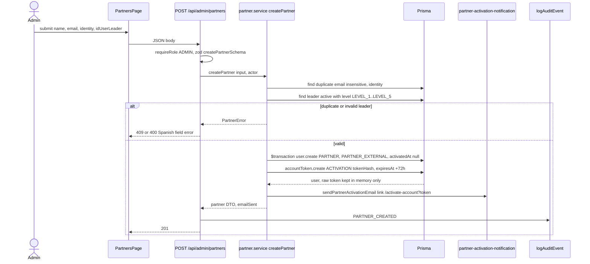

Account activation (AA-03, AA-04, AA-05).

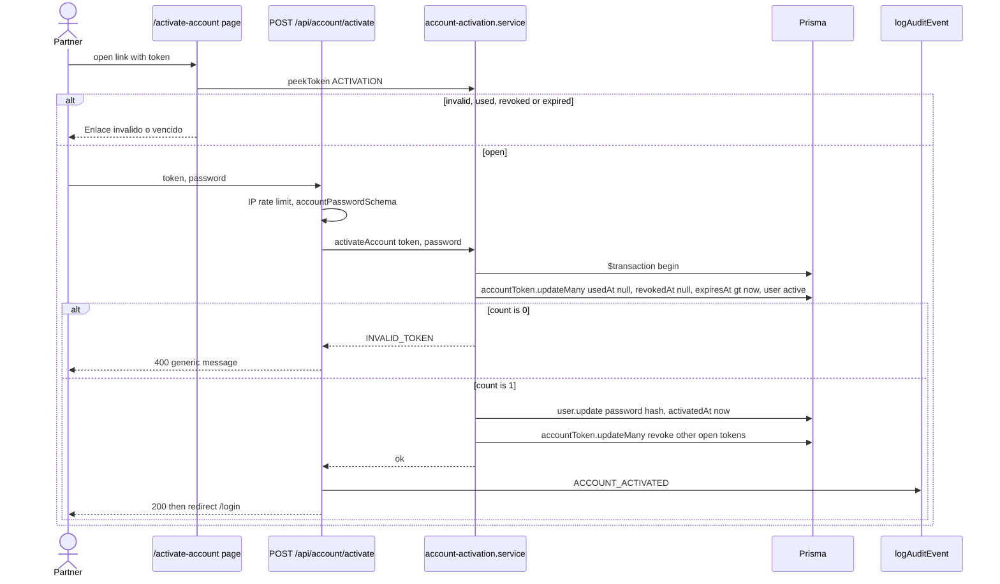

Forgot and reset password (AA-07, AA-08, SEC-04).

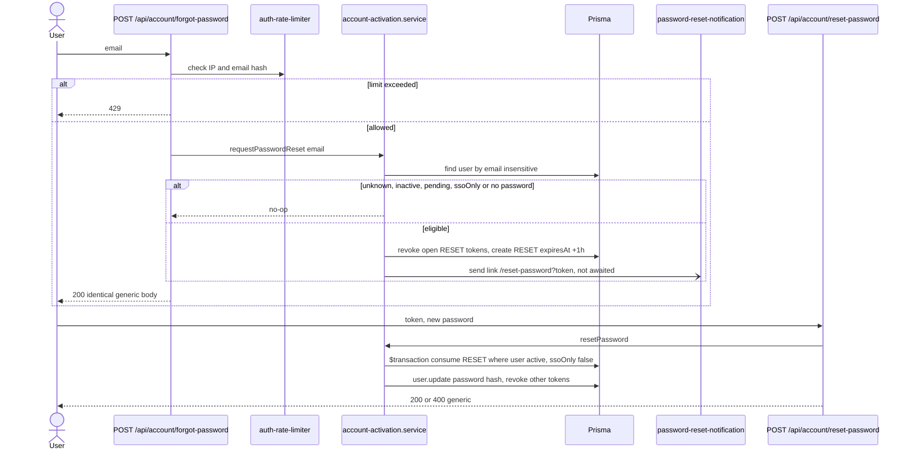

Authenticated request with revalidation and allowlist (SEC-01, SEC-02, SEC-03, PA-01).

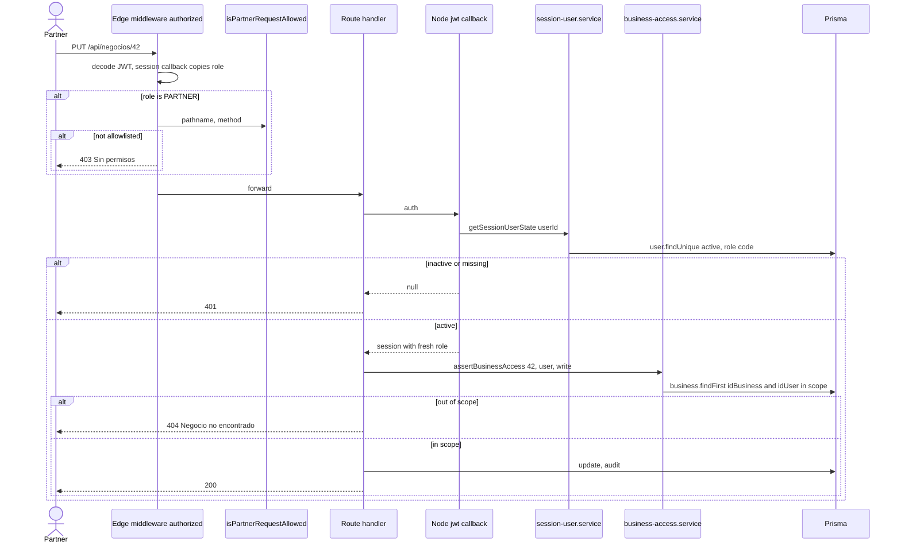

Partner user lifecycle mapped to `active` / `activatedAt` (AA-01, PM-05, PM-06).

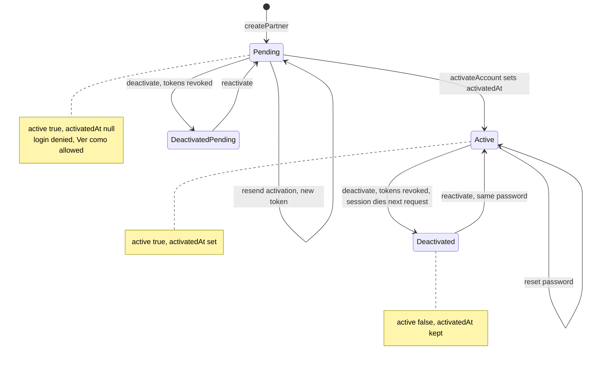

`AccountToken` lifecycle (AA-02, AA-03, AA-06).

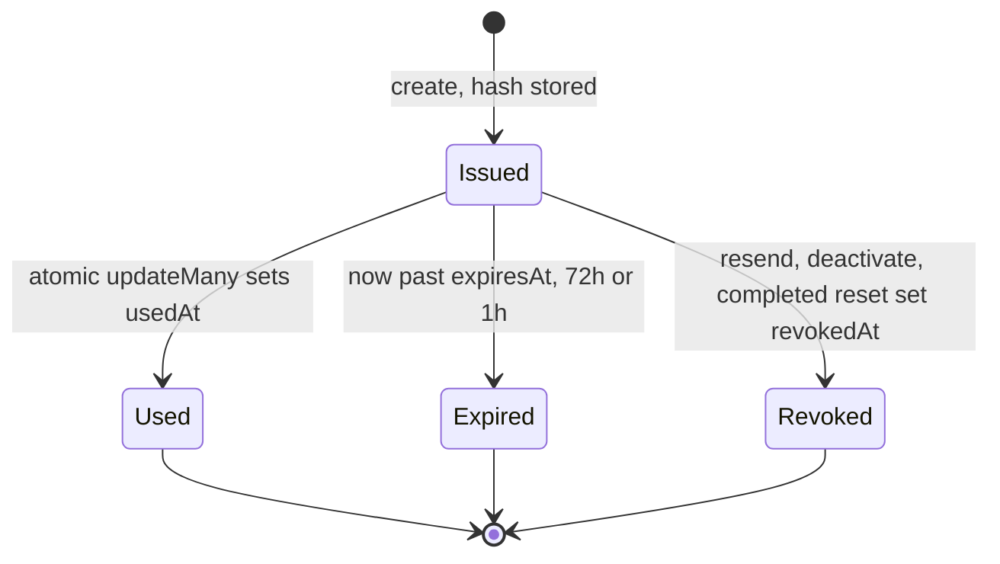

Business access decision (SEC-03, NEG-01, PA-04, CC-01, BS-01).

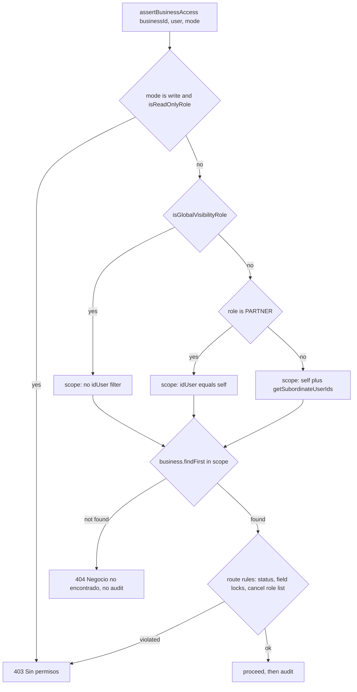

Pre-liquidation exclusion (PL-01, PL-02, PL-03).

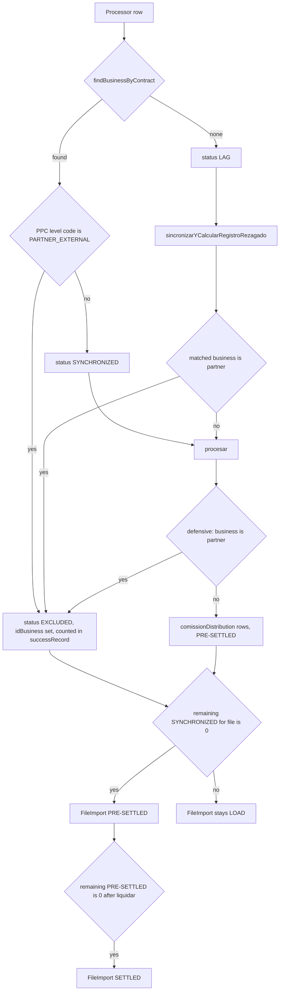

Schema changes (AA-01, AA-02).

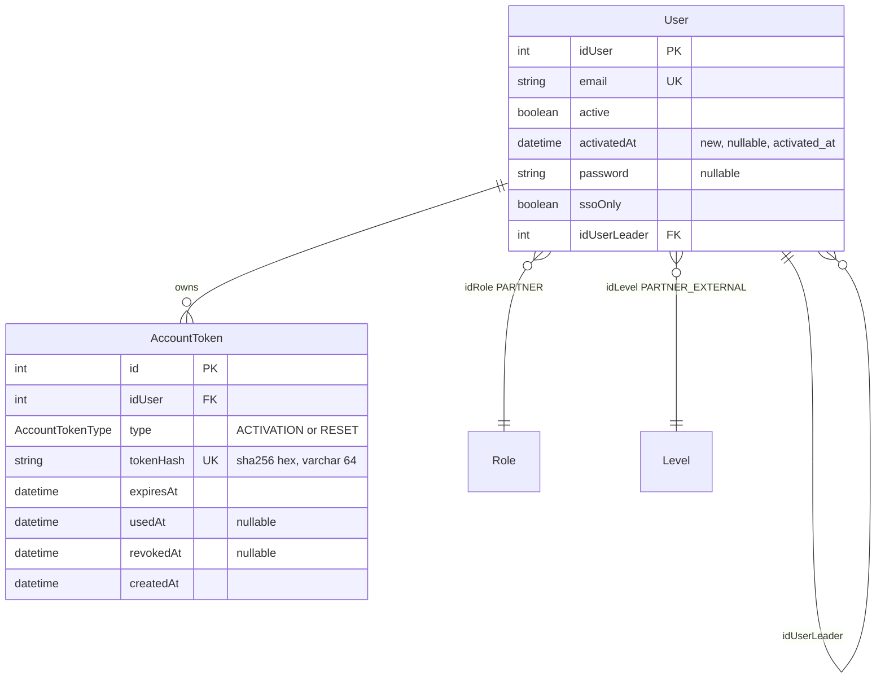

Partner creates a business (NEG-02, PA-04).

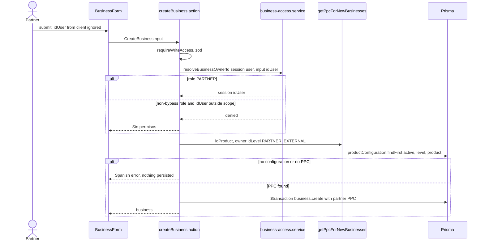

Leader heatmap composition (PD-02, PD-03).

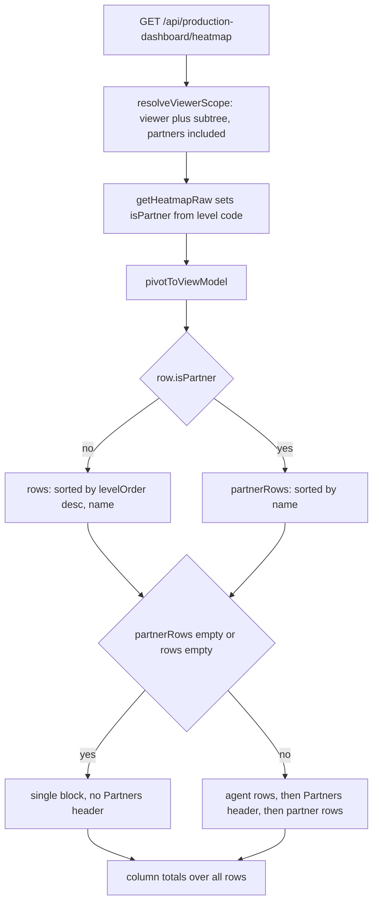

Edge authorization gate (PA-01, SEC-02).

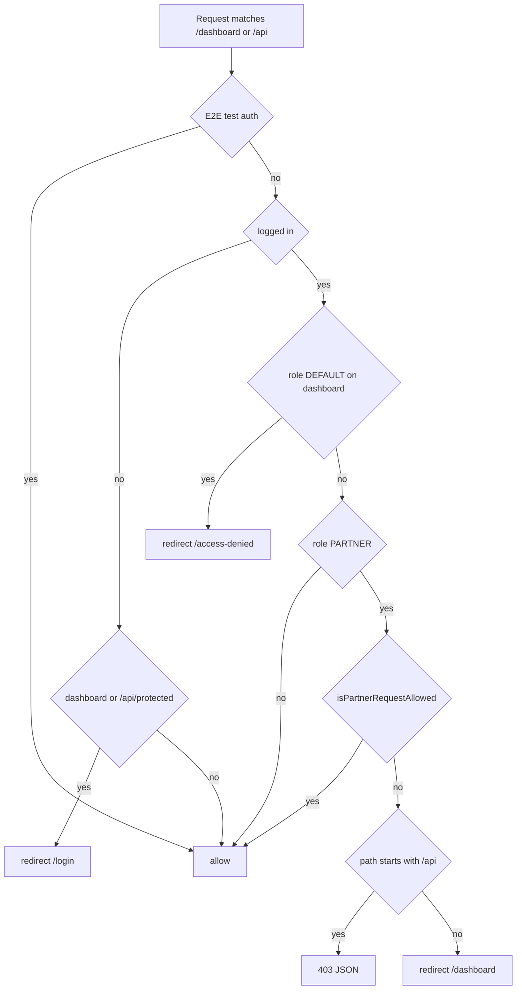

## File Changes

| File                                                                                                                                                                                                                                                                                | Action        | Description                                                                                               |
| ----------------------------------------------------------------------------------------------------------------------------------------------------------------------------------------------------------------------------------------------------------------------------------- | ------------- | --------------------------------------------------------------------------------------------------------- |
| `prisma/schema.prisma`, `prisma/migrations/*_partner_profile/`, `prisma/ERD.md`                                                                                                                                                                                                     | Modify/Create | `User.activatedAt` + backfill, `AccountToken`, enum                                                       |
| `prisma/seeds/partner.ts`, `prisma/seed-partner.ts`, `package.json`                                                                                                                                                                                                                 | Create/Modify | Role, level, category, remediation, coverage gate; script `prisma:seed:partner`                           |
| `prisma/seeds/{roles,level,category}.ts`                                                                                                                                                                                                                                            | Modify        | PARTNER; `PARTNER_EXTERNAL` with `oldCode` equal to `code`, outside `NEXT_LEVEL_CHAIN`; "Partner Externo" |
| `src/features/shared/lib/level-codes.ts`                                                                                                                                                                                                                                            | Create        | `PARTNER_EXTERNAL_LEVEL_CODE`, `PARTNER_LEADER_LEVEL_CODES`, `isDistributionExcludedLevel`                |
| `src/lib/auth/partner-allowlist.ts`                                                                                                                                                                                                                                                 | Create        | Edge-safe allowlist                                                                                       |
| `src/middleware.ts`, `src/lib/auth/auth.config.ts`, `src/lib/auth/config.ts`                                                                                                                                                                                                        | Modify        | Matcher, Edge role callbacks + gate, revalidation                                                         |
| `src/app/dashboard/layout.tsx`                                                                                                                                                                                                                                                      | Create        | Server session guard                                                                                      |
| `src/features/auth/lib/{account-token,account-password.schema,auth-rate-limiter,session-revalidation}.ts`                                                                                                                                                                           | Create        | Pure logic                                                                                                |
| `src/features/auth/services/{account-token,account-activation,session-user}.service.ts`                                                                                                                                                                                             | Create        | Prisma access                                                                                             |
| `src/features/auth/lib/{roles,permissions,audit-logger,user-validation,user-creation}.ts`                                                                                                                                                                                           | Modify        | `PARTNER`, `isBusinessOwnerRole`, audit actions, login rule                                               |
| `src/features/auth/{components,hooks}/` + `src/app/{activate-account,forgot-password,reset-password}/page.tsx`                                                                                                                                                                      | Create        | Public pages, `AsyncState<T>` hook                                                                        |
| `src/app/api/account/{activate,forgot-password,reset-password}/route.ts`                                                                                                                                                                                                            | Create        | Public endpoints                                                                                          |
| `src/features/email/lib/{partner-activation,password-reset}-notification.ts`                                                                                                                                                                                                        | Create        | Emails                                                                                                    |
| `src/features/admin/partners/{types,lib,services,mappers,hooks,components,__tests__}/`                                                                                                                                                                                              | Create        | Partners module                                                                                           |
| `src/app/api/admin/partners/route.ts`, `[id]/{deactivate,reactivate,resend-activation}/route.ts`, `leaders/route.ts`; `src/app/dashboard/admin/partners/page.tsx`                                                                                                                   | Create        | Admin API + page                                                                                          |
| `src/app/api/admin/users/[id]/route.ts`, `[id]/{activate,deactivate}/route.ts`, `set-password/route.ts`, `admin/users/lib/user-role-level-rules.ts`, `hooks/use-leaders.ts`                                                                                                         | Modify        | D10                                                                                                       |
| `src/features/negocios/services/business-access.service.ts`                                                                                                                                                                                                                         | Create        | D4                                                                                                        |
| `src/app/api/negocios/[id]/{route,payments/route,annual-payments/route,mark-novedad/route,comments/route,comprobantes/route,comprobantes/presign/route,comprobantes/[supportId]/route}.ts`, `negocios/services/business-get-by-id.server.ts`, `negocios/actions/create-business.ts` | Modify        | Use the helper                                                                                            |
| `src/features/comments/services/comments.service.ts`                                                                                                                                                                                                                                | Modify        | Partner author notifies like AGENTE                                                                       |
| `src/features/carga-archivos/services/matcher.service.ts`, `load-file/services/processors/{poliza,voluntaria}.processor.ts`, `processor.interface.ts`, `process-batch.service.ts`, `pre-liquidacion/services/pre-liquidacion.service.ts`                                            | Modify        | D5                                                                                                        |
| `production-dashboard/{services/heatmap.service.ts,types/production-kpi.types.ts,hooks/use-heatmap-table.ts}`, heatmap table component, `api/production-dashboard/hierarchy-tree/route.ts`, `shared/services/agent.service.ts`                                                      | Modify        | D11, empty tree, agent filter includes partners                                                           |
| `src/lib/navigation/{menu-items,menu-builder}.ts`, `src/app/login/page.tsx`, `negocios/lib/can-export-business-list.ts`, AGENTE UI branches listed in exploration, calculadora level source                                                                                         | Modify        | Parity, menu, forgot link, export, LVL-01                                                                 |
| `.changeset/partner-profile.md`                                                                                                                                                                                                                                                     | Create        | minor                                                                                                     |

## Interfaces / Contracts

```ts
// negocios/services/business-access.service.ts
type BusinessAccessMode = 'read' | 'write'
type AccessUser = { idUser: number; role?: { code: string } | null }
type BusinessAccessResult = { ok: true; idOwner: number } | { ok: false; status: 403 | 404; error: string }
resolveBusinessScope(prisma, user: AccessUser): Promise<{ idUser?: { in: number[] } }>
assertBusinessAccess(prisma, input: { businessId: number; user: AccessUser; mode: BusinessAccessMode }): Promise<BusinessAccessResult>
resolveBusinessOwnerId(prisma, input: { user: AccessUser; requestedIdUser: number }): Promise<{ ok: true; idUser: number } | { ok: false }>

// lib/auth/partner-allowlist.ts
isPartnerRequestAllowed(pathname: string, method: string): boolean

// auth/services/account-token.service.ts
issueToken(tx, input: { idUser: number; type: AccountTokenType }): Promise<{ rawToken: string; expiresAt: Date }>
consumeToken(tx, input: { rawToken: string; type: AccountTokenType; now: Date }): Promise<{ idUser: number } | null>
revokeOpenTokens(tx, input: { idUser: number; type?: AccountTokenType }): Promise<number>
```

Allowlist: pages `/dashboard` (exact) and `/dashboard/negocios/**`. API: `/api/auth/**`; `/api/negocios` (GET), `/stats`, `/terms`, `/export`, `/validate-contract`; `/api/negocios/:id` (GET, PUT), `/payments`, `/annual-payments`, `/comments`, `/comprobantes`, `/comprobantes/presign`, `/comprobantes/:supportId`, `/mark-novedad`; `/api/clients/search`; `/api/products(/:id)`, `/api/origins`, `/api/periodicities`, `/api/trm`, `/api/reports/me`; `/api/notifications(/stream|/:id)`; `/api/production-dashboard/{kpis,by-status,by-company,by-origin,ms-chart,heatmap,catalogs}`. Everything else is denied, including `cancel`, `manage-novedad`, `fondear*`, `aportes/*`, `hierarchy-tree`, `agents`, `users/search`, `pre-liquidacion/rezagos/autocomplete`.

Routes: `POST /api/admin/partners` 201 `ApiResponse<PartnerDto & { emailSent: boolean }>`, 400/409 on validation or duplicate. `POST /api/account/forgot-password` always `200 { data: { ok: true } }` or 429. `POST /api/account/{activate,reset-password}` `200` or `400 { error: 'Enlace inválido o vencido' }`.

New audit actions: `PARTNER_CREATED`, `PARTNER_DEACTIVATED`, `PARTNER_REACTIVATED`, `PARTNER_ACTIVATION_RESENT`, `ACCOUNT_ACTIVATED`, `PASSWORD_RESET_REQUESTED`, `PASSWORD_RESET_COMPLETED`.

## Testing Strategy

RED first in every row.

| Layer       | What                                                                                                                                                                                                                                                                                                                        | Approach                                 |
| ----------- | --------------------------------------------------------------------------------------------------------------------------------------------------------------------------------------------------------------------------------------------------------------------------------------------------------------------------- | ---------------------------------------- |
| Unit        | `isPartnerRequestAllowed` table (allowed, denied, unknown route, method); `resolveSessionRevalidation`; token hash/TTL; `accountPasswordSchema` (`abcdefgh`, `12345678`, `abc123`, `abcd1234`); limiter; `validateRoleLevelPair`; `pivotToViewModel` partner split; menu                                                    | Vitest pure                              |
| Unit        | `business-access.service` matrix: ADMIN, CONSULTOR, AGENTE own/subordinate/foreign, PARTNER own/foreign, unknown role                                                                                                                                                                                                       | Mocked Prisma                            |
| Integration | One ownership test per negocios sub-route for agent and partner; `createBusiness` forces `idUser`; partner create (duplicate, leader level); token consume under `Promise.all` (exactly one success); forgot-password identical bodies; users-module guards; processors emit `EXCLUDED`; mixed and partner-only file status | Vitest integration, route handlers       |
| Integration | `authorized` with a PARTNER session returns 403/redirect; ADMIN and AGENTE unchanged; unauthenticated `/api/health`, `/api/leads/crm-sync` unchanged; Edge session exposes `role`                                                                                                                                           | Call `authConfigEdge.callbacks` directly |
| Integration | Inventory: every `'use server'` file calls a guard                                                                                                                                                                                                                                                                          | Static scan test                         |
| E2E         | Create partner, activate, log in, create business, denied pages; deactivate ends the session on next navigation                                                                                                                                                                                                             | Playwright                               |

## Threat Matrix

The reference matrix covers documentation paths, Git selection, commit/push state and PR commands. None of those boundaries is touched.

| Boundary                 | Applicability                            |
| ------------------------ | ---------------------------------------- |
| Documentation-like paths | N/A: no file classification or execution |
| Git repository selection | N/A: no Git automation                   |
| Commit state             | N/A: no Git automation                   |
| Push state               | N/A: no Git automation                   |
| PR commands              | N/A: no PR automation                    |

The change does alter HTTP routing, so these are design requirements that carry to tasks unchanged:

| Case                                                                                                   | Safe behavior                                  | RED test                       |
| ------------------------------------------------------------------------------------------------------ | ---------------------------------------------- | ------------------------------ |
| Partner calls a non-allowlisted or newly added `/api` route                                            | 403 at Edge                                    | allowlist table + `authorized` |
| Path tricks (`/api/negocios/1/cancel`, trailing slash, case, encoded segments, `/dashboard/negociosX`) | Denied; anchored regexes on `nextUrl.pathname` | allowlist table                |
| Partner invokes a foreign Server Action through an allowed page URL                                    | Action's own guard rejects                     | `'use server'` inventory       |
| Stale JWT after deactivation or role change                                                            | Node `auth()` returns null; role refreshed     | revalidation tests             |
| Impersonating admin is deactivated                                                                     | Session ends                                   | revalidation tests             |
| Matcher on `/api` breaks public or service routes                                                      | Non-partner requests pass through              | regression tests               |
| Token reuse, race, expiry, revoked, deactivated user                                                   | Generic 400, no state change                   | token tests                    |
| Account enumeration through body, status or rate limit                                                 | Identical responses; limiter keyed on input    | forgot-password tests          |

## Migration / Rollout

1. `prisma migrate deploy`: adds `activated_at` (backfilled from `created_at`), `account_token`, enum. Additive.
2. `npm run prisma:seed:partner`: role, level, category, then remediation for missing `PARTNER_EXTERNAL` configurations; fails if any active product lacks a partner PPC.
3. Deploy the app. Verify in QA: a large `carga-archivos` upload still works with the `/api` matcher; SSE `/api/notifications/stream`; an existing agent session survives.
4. Release notes: agents lose access to businesses outside self+subordinates.

Rollback: revert the PR; set partner users `active=false`; down migration drops `account_token` and `activated_at`. The level and configurations stay inert. `EXCLUDED` rows are ignored by the old code's status filters.

## Open Questions

- [ ] If the QA seed dry run reports `CODE_TOO_LONG`, widen `ProductConfiguration.code` or shorten the level segment? `PARTNER_EXTERNAL` is 9 characters longer than `LEVEL_n`, and `create-product.service` fails the whole product when any code overflows.
- [ ] `liquidar-archivo` on a file with only `EXCLUDED` rows: design sets `SETTLED` directly. Confirm against PL-02 wording.

## Resolved by product owner (2026-10-10)

These decisions OVERRIDE any conflicting statement earlier in this design and in the specs; `sdd-tasks` must plan from them.

| Topic                                                                              | Decision                                                                                                                                                                                                                                                                 |
| ---------------------------------------------------------------------------------- | ------------------------------------------------------------------------------------------------------------------------------------------------------------------------------------------------------------------------------------------------------------------------ |
| `mark-novedad` MARK                                                                | **Unchanged for internal users** (no new scope check on MARK for non-PARTNER roles; UNMARK keeps its current ownership rule). **PARTNER may mark/unmark only their own businesses** (COM-41).                                                                            |
| Create business on behalf of a partner                                             | **Allowed for bypass roles (admin/support)**, same as for agents today. A PARTNER session always creates with `idUser = session user`.                                                                                                                                   |
| `/api/pre-liquidacion/rezagos/autocomplete`                                        | **Unchanged, also available to PARTNER** — add it to the partner allowlist. **Accepted risk:** a partner can see other users' lagged contracts.                                                                                                                          |
| Origin change on a partner business (`PUT /api/negocios/[id]`, "cambio de origen") | **Same rule as today** (only on `EMITIDO`). For businesses whose PPC belongs to a `PARTNER_EXTERNAL` configuration, skip `validateProductConfigurationExists` category-line check and skip commission recalculation; persist the new origin only. Covered by a RED test. |
