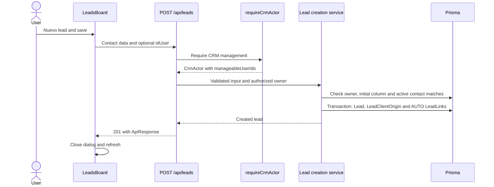
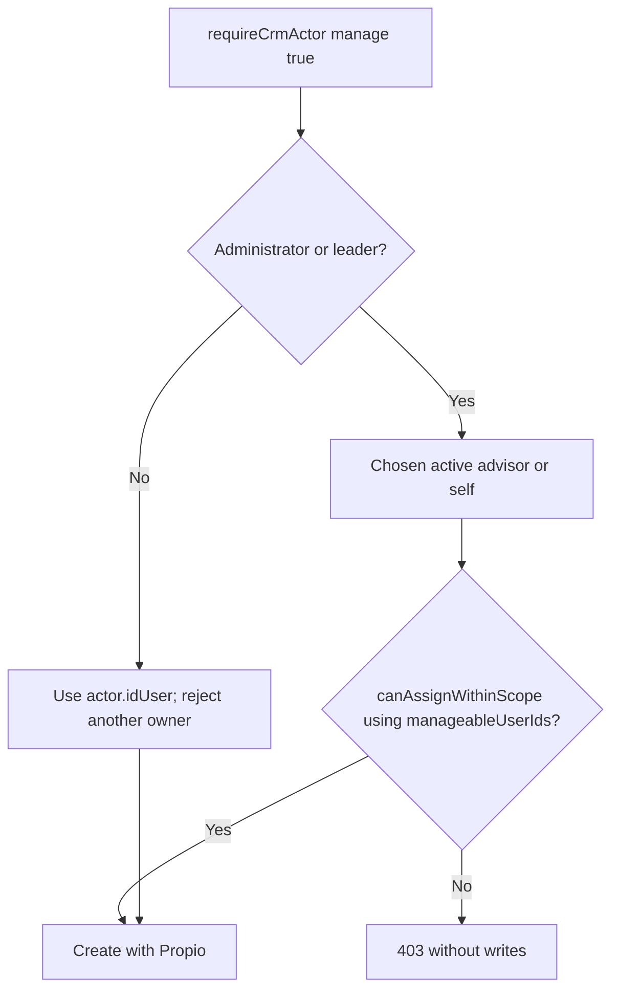
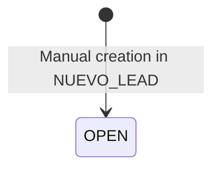

# Design: Manual pipeline leads

## Decisions

1. Extend `POST /api/leads`, alongside the existing board `GET`. Authenticate with `requireCrmActor('leads_module', { manage: true })`, validate with a dedicated Zod schema, and delegate persistence to a lead feature service. A browser session, not the integration API key, authenticates this action.
2. Reuse the hierarchy policy and advisor selector. Leaf advisors default to themselves and cannot submit another owner. Administrators and leaders may choose an active advisor or keep the explicit self-assignment default; `canAssignWithinScope` must receive the actor's write scope. Advisor eligibility follows the existing active-user hierarchy policy. A company-wide read grant must never widen assignment rights.
3. Create a native `Lead` with no fabricated `externalCrmId`, `outcomeStatus: OPEN`, the active `NUEVO_LEAD` column, and `originTag: Propio`. Resolve the existing origin through the shared service and link `LeadClientOrigin` in the same transaction. An inactive origin or missing initial column produces a useful error without a partial lead; a missing origin may be created by `resolveLeadOrigin`, preserving its existing semantics.
4. Before creation, fetch every active lead matching any nonempty document, email or phone. Escape case-insensitive email equality so wildcard characters remain literal. Always create a distinct lead with the authorized advisor; atomically insert an `AUTO` `LeadLink` from it to each match, with the `Propio` origin and real creator. Never overwrite contacts or reassign existing owners. Existing timeline queries read links from either endpoint, so both sides show the relationship without copying activities or widening API visibility. Use a neutral automatic-relation label because linked leads may have different advisors.
5. Reuse shared dialog, inputs, `SingleSelect`, hierarchy advisors and `AsyncState` mutation conventions. Disable repeated submission while saving; keep the form open on failure and refresh the board/origin options on success. Record `LEAD_CREATED` with the real actor and reuse manual origin/stage history where supported.

## Diagrams

The creation request crosses UI, authorization, service and persistence layers (manual creation and atomic origin requirements).

Write scope controls ownership independently of read visibility (ownership authorization requirement).

Manual creation initializes the existing lead lifecycle without introducing another status (initial state requirement).

## Verification

Focused schema, route, service and UI tests cover valid creation, empty/invalid input, self-assignment, authorized delegated assignment, forbidden cross-branch assignment, read-grant isolation, inactive owner/origin, missing stage, repeated contacts linked to all active matches, literal email matching, relation history on both endpoints, link-persistence rollback, and submission errors. Run type checking and lint on touched files; report any unavailable runtime verification.
