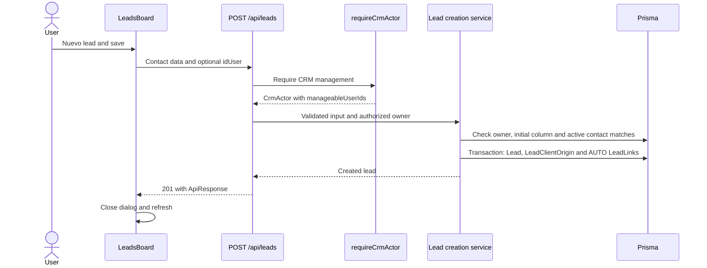
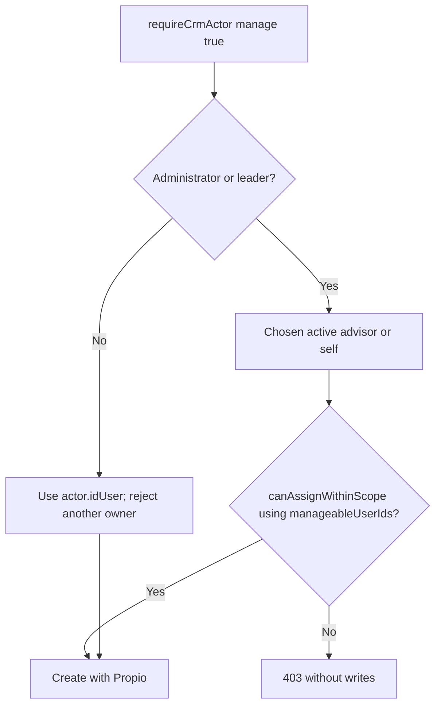
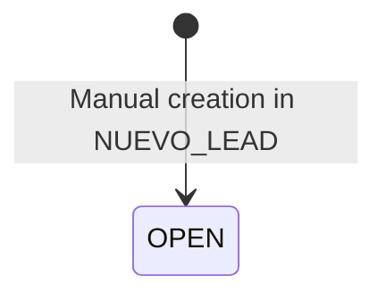
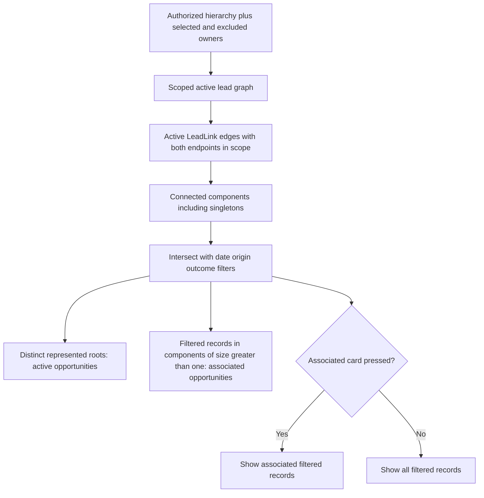

# Design: Manual pipeline leads

## Decisions

1. Extend `POST /api/leads`, alongside the existing board `GET`. Authenticate with `requireCrmActor('leads_module', { manage: true })`, validate with a dedicated Zod schema, and delegate persistence to a lead feature service. A browser session, not the integration API key, authenticates this action.
2. Reuse the hierarchy policy and advisor selector. Leaf advisors default to themselves and cannot submit another owner. Administrators and leaders may choose an active advisor or keep the explicit self-assignment default; `canAssignWithinScope` must receive the actor's write scope. Advisor eligibility follows the existing active-user hierarchy policy. A company-wide read grant must never widen assignment rights.
3. Create a native `Lead` with no fabricated `externalCrmId`, `outcomeStatus: OPEN`, the active `NUEVO_LEAD` column, and `originTag: Propio`. Resolve the existing origin through the shared service and link `LeadClientOrigin` in the same transaction. An inactive origin or missing initial column produces a useful error without a partial lead; a missing origin may be created by `resolveLeadOrigin`, preserving its existing semantics.
4. Before creation, fetch every active lead matching any nonempty document, email or phone. Escape case-insensitive email equality so wildcard characters remain literal. Always create a distinct lead with the authorized advisor; atomically insert an `AUTO` `LeadLink` from it to each match, with the `Propio` origin and real creator. Never overwrite contacts or reassign existing owners. Existing timeline queries read links from either endpoint, so both sides show the relationship without copying activities or widening API visibility. Use a neutral automatic-relation label because linked leads may have different advisors.
5. Reuse shared dialog, inputs, `SingleSelect`, hierarchy advisors and `AsyncState` mutation conventions. Disable repeated submission while saving; keep the form open on failure and refresh the board/origin options on success. Record `LEAD_CREATED` with the real actor and reuse manual origin/stage history where supported.

## Diagrams

The creation request crosses UI, authorization, service and persistence layers (manual creation and atomic origin requirements).

Write scope controls ownership independently of read visibility (ownership authorization requirement).

Manual creation initializes the existing lead lifecycle without introducing another status (initial state requirement).

## Verification

See the scoped opportunity amendment below for its additional graph, filtering and accessibility checks.

Focused schema, route, service and UI tests cover valid creation, empty/invalid input, self-assignment, authorized delegated assignment, forbidden cross-branch assignment, read-grant isolation, inactive owner/origin, missing stage, repeated contacts linked to all active matches, literal email matching, relation history on both endpoints, link-persistence rollback, and submission errors. Run type checking and lint on touched files; report any unavailable runtime verification.

## Amendment: Scoped opportunity groups and associated view

Build the graph from active hierarchy-visible leads after selected owners and expanded excluded hierarchy branches. Treat active `LeadLink` records as undirected edges, regardless of `AUTO` or `MANUAL` source, retaining an edge only when both distinct endpoints belong to that graph scope. Invisible, inactive or excluded branch members never connect or expose records.

Apply date, origin and outcome filters after graph grouping to obtain the base displayed lead population. **Oportunidades activas** equals the number of distinct connected-component roots represented by those filtered records, including singletons. **Oportunidades asociadas** equals the number of filtered records whose scoped component has more than one member. A visible out-of-date, different-origin or different-outcome intermediary can connect two matching records; an invisible or branch-excluded intermediary cannot. Components without a displayed member contribute zero.

For A—B—C plus unrelated D, the cards show 2 active opportunities and 3 associated records when all match. If B fails the date filter, the cards show 2 active opportunities and 2 associated records for displayed A, C and D. A triangle or reversed/duplicate edges do not increase group/member counts. Self-links do not make a singleton associated.

Reuse existing board scope/filter builders and a small pure graph helper. Return only required aggregates or flags/IDs for already-visible displayed leads, not hidden graph endpoints or contacts. Preserve existing board response callers, CRM task/case metrics and feature flags. No schema or dependency changes are needed.

Make the associated card a keyboard-accessible button with an explicit pressed state. Its toggle filters displayed cards to associated members and toggles back to the full base board. Counts always use the un-toggled filtered base population. Ordinary filter changes, refresh and successful lead creation update graph membership and counts. Empty scope yields zero counts and an empty board. This is read-only behavior; existing record and write authorization remain unchanged.

The graph is built within hierarchy/owner scope before ordinary filters; the toggle changes displayed members without shrinking base summary counts (grouped count and associated view requirements).
