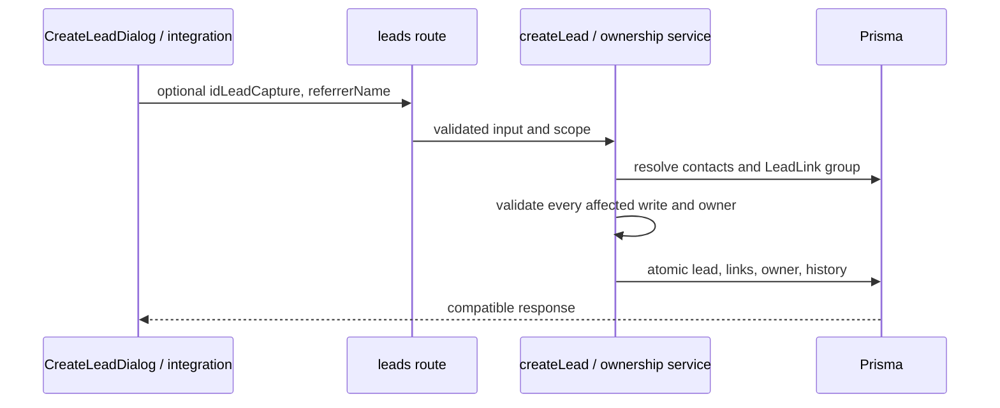
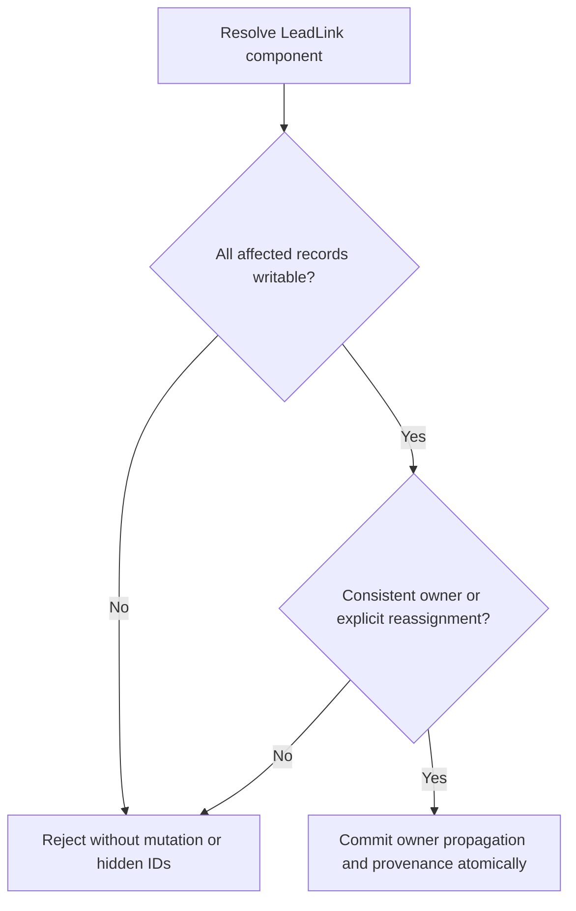
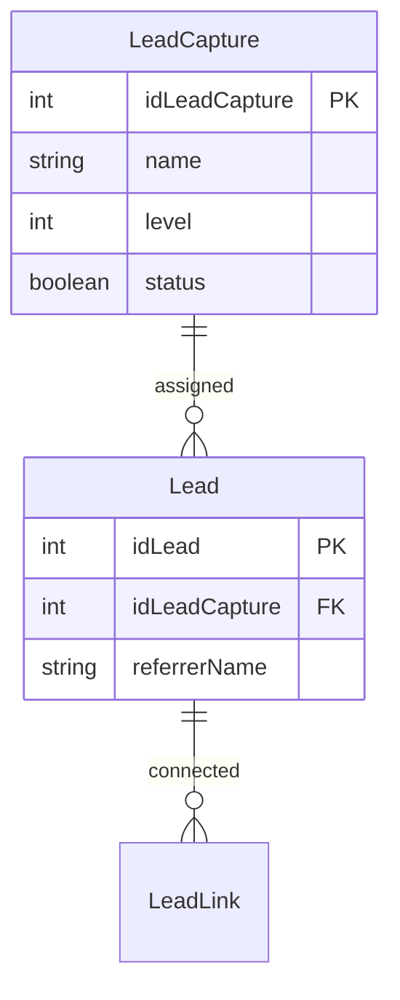
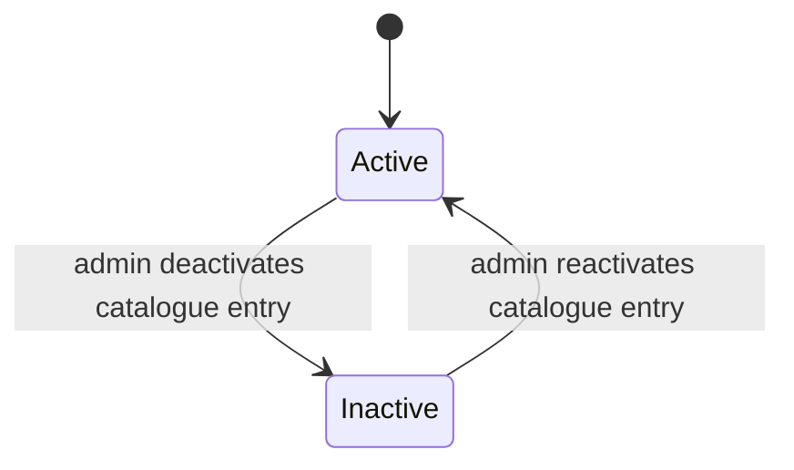

## Context
Reuse LeadLink and existing association graph, createLead/findSamePersonLead, origin resolution, timeline and permission services. Maintain feature services for Prisma; routes validate/authorize HTTP only. Async hooks use AsyncState. No new dependency or Person aggregate.

## Goals / Non-Goals
Separate attribution, group visible opportunities, consolidate history and enforce authorized group ownership. No sessions, consumption or automatic capture lifecycle transitions.

## Decisions
### Additive model and API
Add LeadCapture { idLeadCapture Int PK, name String unique, level Int >= 0, status Boolean default true, createdAt, updatedAt }; nullable Lead.idLeadCapture FK and Lead.referrerName String (trimmed, max 200). One capture per Lead; multiple Leads per person remain distinct and active. Existing ClientOrigin/LeadClientOrigin and originTag remain unchanged. No capture/status inference from legacy text.

Authenticated active-catalogue GET /api/leads/captures returns {idLeadCapture,name,level,status}, sorted level/name/id. Admin GET/POST /api/admin/lead-captures and PUT /api/admin/lead-captures/[id] reuse origin-administration authorization and response conventions. Validate names/nonnegative integer levels/boolean status; reject duplicate names. Deactivate rather than delete. Existing assigned inactive captures remain visible; forbid new assignment to inactive captures, allow retaining unchanged assignment.

Native create, webhook/landing ingestion and CSV accept optional idLeadCapture/referrerName; old inputs remain valid. Native source remains Propio. Validate supplied capture identifiers; omitted fields do not clear existing attribution on retry/update. Existing explicit attribution is never overwritten automatically. No hidden changes to webhook response envelopes or identity/idempotency rules.

Lead DTOs include capture/referrer. Pipeline grouping returns one representative plus visible associated opportunities; each opportunity preserves idLead/stage/outcome/owner/capture/source/referrer. Card selector and sheet choose a specific idLead; every mutation targets selected opportunity except owner reassignment, which targets its full group. Counts and filters count visible groups once; a matching opportunity selects the representative. Additive group DTO fields are personKey (number) and captures (opportunities with idLead, capture, idLeadFunnelColumn, outcomeStatus, originTag, referrerName). The representative is highest capture level, then latest createdAt/idLead among filtered visible members. Groups use only authorized visible nodes/edges; no hidden counts, contacts or IDs.

### Matching, ownership and attribution
Resolve complete active LeadLink components server-side for writes. Preserve existing all-contact OR matching: every active Lead matching any supplied normalized nonempty document, case-insensitive escaped email or phone is a candidate; link all matching records and their components. Never narrow matches by contact priority or to one component; never match by name. Resolve the full union before mutation. Acquire transactionally consistent membership and full write authorization for every affected record before any writes; inaccessible records produce a generic denial with no IDs and rollback. Trusted integration authorization explicitly covers its affected scope.

An explicitly selected authorized advisor in native creation is authoritative and propagates across the complete group. A valid resolved ownerEmail from trusted ingestion is likewise authoritative and propagates. An omitted or unmatched incoming owner inherits the unique existing non-null owner; a wholly unowned group may retain null or use an authorized default according to its existing ingress contract. Conflicting existing non-null owners without an explicit authorized target produce a generic 409; never silently choose one. Manual relation follows the same full-union authorization and explicit-target rule. Reassignment propagates to every affected group Lead in one transaction and appends per-record history with actual actor/source. All callers share the same ownership enforcement; route-only checking is insufficient. Retry or reject concurrent membership/owner conflicts atomically.

Each Lead retains its own observed acquisition/referrer. No propagation of origin/referrer over existing leads. Earliest source/referrer display comes from earliest visible persisted attribution event (timestamp then ID); missing legacy provenance is shown unknown, never invented. New capture does not cancel/deactivate any existing capture or Lead.

### Timeline
Aggregate existing activity, stage, change and ingress sources for all visible group Leads; include source idLead/capture, stable event key, original timestamp and actual actor. Human actor comes from persisted author; automatic entry shows Sistema, never assigned strategist. Merge sorted timestamp/type/id with stable group pagination and deduplicate identical source event IDs; load complete history through pagination. Do not expose invisible group membership in items, totals or cursors. Legacy unknown authors remain unknown.

## Diagrams
Sequence covers attribution and transactional ownership across layers.

Authorization covers full-group mutation.

Schema covers nullable capture assignment.

Catalogue validity never changes existing Lead activity.

## Migration and Risks
Add nullable FK/text and catalogue without seeding guessed labels or rewriting data. Run Prisma generation and migration against private disposable database only. Shared contacts can be ambiguous: reject unsafe matches. Partial visibility means visible projection may split a full group; write scope still checks complete group. Timeline pagination must be group-wide to avoid skipped interleaved events.

## Delivery boundaries and deployment
Work is isolated to branch `feature/crm-person-captures` in `/Users/warlesrivera/Documents/dev/warles/Conexion/.worktrees/crm-person-captures`. Do not mutate other worktrees, existing QA/production records, or unrelated user changes. Prior native creation/automatic links/group-count commits are retained. No sessions, entitlements, consumption, automatic cancellation/supersession, Person table or destructive attribution backfill.

Deploy the additive Prisma migration before the application that reads the new columns. Generate Prisma with the repository's installed tooling; validate and exercise migration/rollback against a private disposable database first. No new environment variables, cron jobs or background workers are required. Existing integrations may omit all new fields. Application rollback retains the additive schema and captured data; do not drop catalogue/attribution records.

Landing-specific matching keeps the legacy document/email/phone ambiguity fail-closed contract when capture is omitted. Explicit capture submissions may reuse a matching capture within one persisted group; different captures create separate active linked opportunities. Contact candidates spanning unrelated components remain ambiguous and are rejected for landing submissions. Trusted webhook/CSV retain their all-contact OR behavior.
