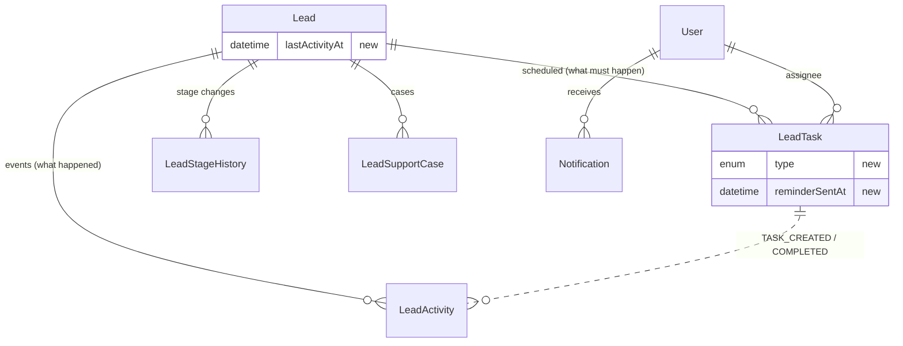
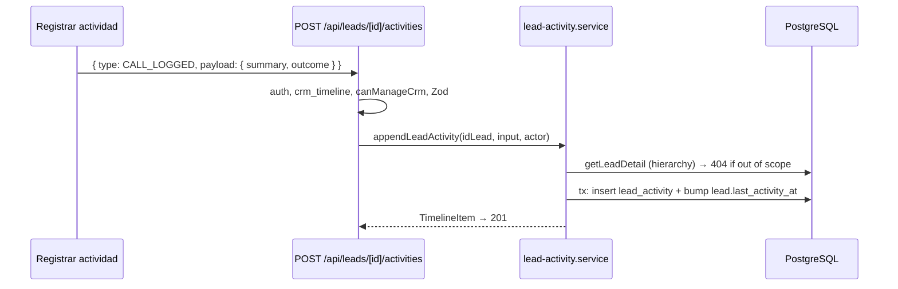
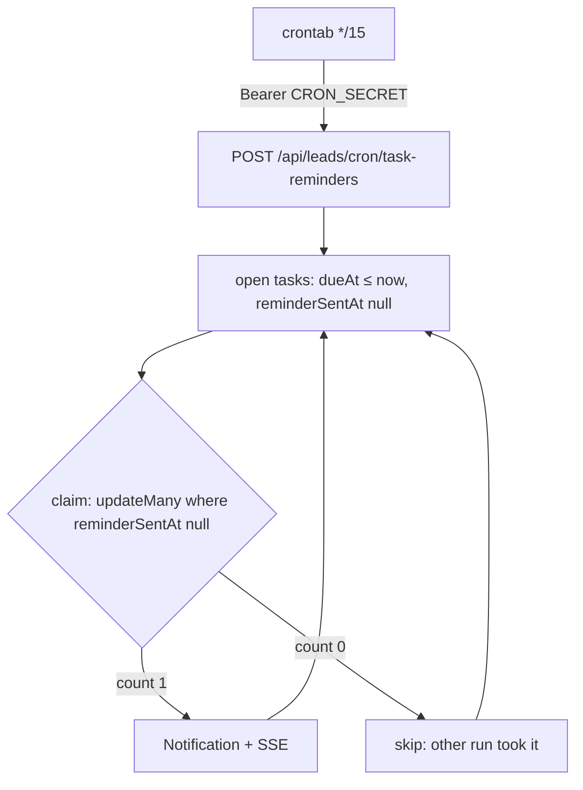
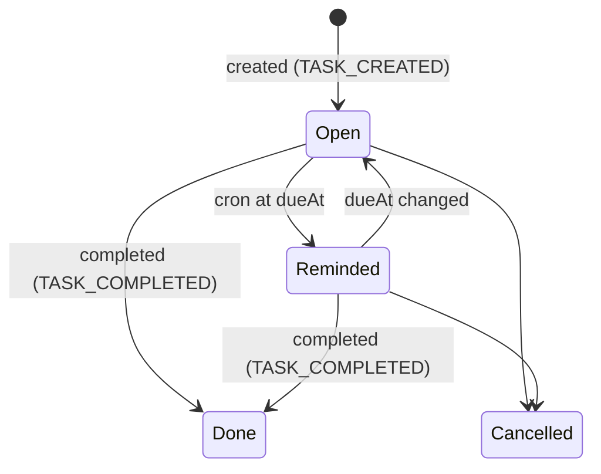

# Design: CRM Phase 1 — Activities, Agenda & Reminders

Base: `codex/negocios-basic-crm` (Andrés) + Phase 0, on branch `feature/crm-on-basic-crm`.

## D1. Keep Andrés's two-model split (Odoo-style)

- **`LeadActivity`** = what *happened* (append-only event log, JSON `payload`, `payloadVersion`, idempotent `correlationId`). Equivalent to Odoo's chatter / Twenty's `timelineActivity`.
- **`LeadTask`** = what *must happen* (scheduled, has `dueAt`, `assignedTo`, `status`). Equivalent to Odoo's `mail.activity`. Completing a task appends `TASK_COMPLETED`.

**Why not my earlier single `LeadActivity` model:** it collided with Andrés's table and enum names and mixed past events with future work. His split is the one Odoo and EspoCRM use, and it already has services, routes and tests.

## D2. Schema changes (one migration `extend_lead_activity_and_task`)

```prisma
enum LeadActivityType {
  // existing: NOTE_ADDED TASK_CREATED TASK_COMPLETED TASK_REASSIGNED
  //           CONVERTED BUSINESS_LINKED CASE_OPENED CASE_UPDATED
  CALL_LOGGED
  MEETING_LOGGED
  EMAIL_LOGGED
  WHATSAPP_LOGGED
}

enum LeadTaskType { TODO CALL MEETING EMAIL WHATSAPP }

model LeadTask {
  // + 
  type           LeadTaskType @default(TODO)
  reminderSentAt DateTime?    @map("reminder_sent_at")
  @@index([dueAt, reminderSentAt])
}

model Lead {
  // +
  lastActivityAt DateTime? @map("last_activity_at")
  @@index([outcomeStatus, lastActivityAt])
}
```

`STAGE_CHANGED` is **not** added to the DB enum: `LeadActivity.idUser` is required and the webhook has no actor. Stage changes stay in `LeadStageHistory` (Phase 0) and are merged at read time (D4).

## D3. Client-submittable events

`lead-crm-event.schema.ts`: `leadCrmEventInputSchema` becomes `z.discriminatedUnion('type', [...])`:

| type | payload (strict) |
|---|---|
| `NOTE_ADDED` | `{ note }` (unchanged) |
| `CALL_LOGGED` / `MEETING_LOGGED` / `EMAIL_LOGGED` / `WHATSAPP_LOGGED` | `{ summary, outcome?: 'CONNECTED' \| 'NO_ANSWER' \| 'LEFT_MESSAGE' \| 'RESCHEDULED', durationMinutes?: 1..600, occurredAt?: ISO ≤ now }` |

Same `plainText` rule (no HTML, ≤ 2000). `occurredAt` maps to the column `occurred_at`. Lifecycle types stay service-only.

`appendLeadActivityTx` bumps `lead.lastActivityAt = GREATEST(current, occurredAt)` for `NOTE_ADDED`, `*_LOGGED`, `TASK_COMPLETED`, `CONVERTED` (same tx). System-only types (`CASE_UPDATED` from automation, etc.) also count only when actor-originated — kept as a const set `ACTIVITY_TYPES_COUNTING_AS_CONTACT` in `activities/`.

## D4. Timeline with stage changes

`getLeadTimelinePage(idLead, cursor)` in `activities/lead-timeline.service.ts`:
1. `getLeadActivityPage` (Andrés, unchanged).
2. `LeadStageHistory` page with the same compound cursor `(occurredAt=changedAt, id)`.
3. Pure `merge-timeline.ts`: merge by `occurredAt desc`, tie-break `kind` then `id desc`, truncate to `limit`. Cursor becomes `{ occurredAt, kind, id }` encoded `iso|kind|id`; the old `iso|id` format is still accepted (kind = `activity`).

`LeadActivityTimeline` renders `STAGE_CHANGED` items as "Etapa: A → B" with a source tag (GHL / CSV / Manual).

## D5. Agenda

`tasks/lead-task-agenda.service.ts` → `getTaskAgenda(viewerId, bucket, now)`; bucket ranges via pure `tasks/agenda-bucket-range.ts` using `bogota-date.ts`:
- `overdue`: `status OPEN`, `dueAt < startOfTodayBogota`
- `today`: `status OPEN`, `dueAt` within today
- `upcoming`: `status OPEN`, `dueAt` in (today, +14d] **or** `dueAt null`
- `done`: `status DONE`, `completedAt ≥ now − 7d`

Always `assignedTo = viewer`, `lead.active = true`. Route `GET /api/crm/tasks` (new `route.ts` next to Andrés's `[id]`), gated by `crm_tasks` + `canAccessCrm`.

## D6. Reminders & digest

- `tasks/lead-task-reminder.service.ts`:
  - `sendDueTaskReminders(now)`: `status OPEN`, `dueAt ≤ now`, `reminderSentAt null`, `take 500`. Per task: claim with `updateMany({ where: { idLeadTask, reminderSentAt: null }, data: { reminderSentAt: now } })` → only if `count = 1`, create `Notification` (callback `/dashboard/negocios/crm?tab=actividades&lead={idLead}`) and SSE push. Claim-first prevents double notification on overlapping runs.
  - `sendDailyTaskDigest(now)`: group overdue + today by assignee, email via `email-service.ts` with new template `email/lib/crm-task-digest-email.ts`; skip empty; per-user failures to Sentry.
- Andrés's `updateLeadTask` path: when `dueAt` changes, set `reminderSentAt = null`.
- Cron routes under `src/app/api/leads/cron/`; `verifyCronSecret` extracted to `src/lib/auth/verify-cron-secret.ts` and reused by `fund-payments`.
- Crontab (QA + prod workflows): `*/15 * * * *` reminders, `0 12 * * *` digest.

## D7. UI

- `crm-tabs.ts`: `Actividades` enabled when `crm_tasks` is on (tab entry gets an optional `flag`). Component `ActivitiesAgenda` with four groups; row click opens `LeadDetailSheet`.
- `crm-tabs.tsx`: reads `?tab=` and `?lead=`.
- Detail sheet: Andrés's note box becomes "Registrar actividad" with a type selector (Nota, Llamada, Reunión, Email, WhatsApp); task form gains the type selector.
- `InactivityBadge` on `lead-card.tsx` and sheet header; threshold comes in the board payload (`inactivityThresholdDays`), never from client env.
- Mockup frame "CRM — Actividades" in `Financiera.pen` before UI tasks.

## D8. Architecture cleanup in Andrés's routes

`CLAUDE.md` forbids Prisma in route handlers. Move the inline queries of `api/leads/[id]/activities`, `api/leads/[id]/tasks`, `api/leads/[id]/cases`, `api/crm/tasks/[id]`, `api/crm/cases/[id]` into `activities/`, `tasks/`, `cases/` services (`withTransaction` wrappers around the existing `*Tx` functions). Behavior unchanged; existing route tests must stay green. Also extract the repeated `resolveCrmContext` into `crm/resolve-crm-route-context.ts`.

## Diagrams

### Data model after Phase 1


### Log a call


### Reminder job


### Task lifecycle

